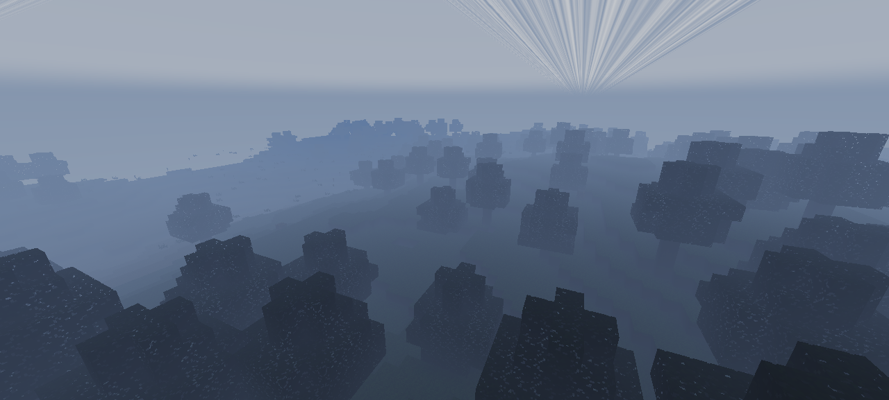
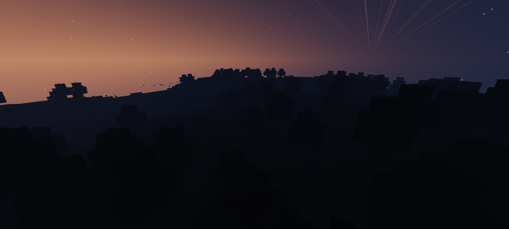
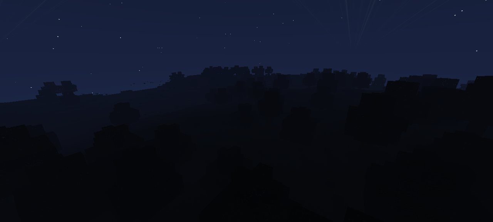
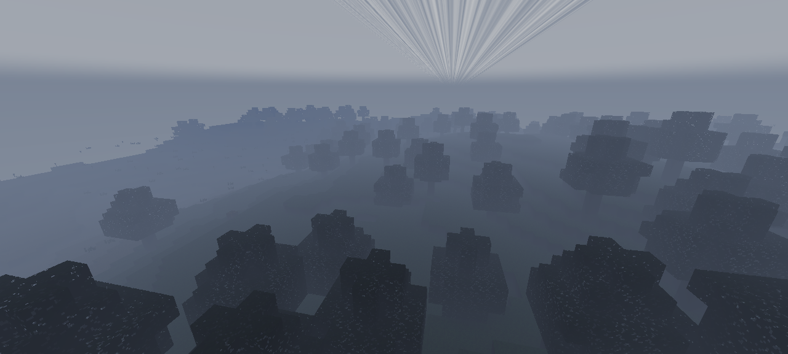

# 🌳 Shader Lab — Minecraft シェーダープレビューア

ブラウザ上で **Minecraft のシェーダーパック**を時間・天候を自在に変えながら **3D 視点移動**でプレビューできる静的サイトです。サーバー不要・ビルド不要で、そのまま GitHub Pages で公開できます。

## 🖼️ スクリーンショット

| 昼 | 夕焼け |
|:---:|:---:|
|  |  |

| 夜 | 雷 |
|:---:|:---:|
|  |  |

※同じワールドの時間と天候だけを変えています。

## ✨ できること

- **シェーダーパックの読み込み** — OptiFine / Iris 形式（`shaders/` フォルダ入り `.zip`）をドラッグ＆ドロップで読み込み
- **時間の操作** — ワールド時間（0〜24000 tick）をスライダー / プリセット（夜明け・昼・夕焼け・夜）/ 自動サイクルで変更
- **天候の操作** — 晴れ / 雨 / 雷（稲妻フラッシュ付き）。雨の強さも手動調整可能
- **3D プレビュー** — マウスドラッグで視点、WASD で移動、ホイールでズーム（旋回モード / FPS 飛行モード）
- **内蔵シェーダー** — 「Soft Light」（影・空・水面反射・雲・ブルーム）と「バニラ風」を同梱
- **デバッグ機能** — colortex / depth / shadow バッファをそのまま表示するバッファビューア、プログラム単位のコンパイル状態表示
- **スクリーンショット** — ワンクリックで PNG 保存

## 🚀 GitHub Pages での公開手順

1. このフォルダ（`minecraft-shader-lab/`）の中身をすべて、自分のリポジトリの**ルート**に配置します（`index.html` がルートに来るように）。
   ```bash
   git init && git add . && git commit -m "Shader Lab"
   git branch -M main
   git remote add origin https://github.com/<ユーザー名>/<リポジトリ名>.git
   git push -u origin main
   ```
2. GitHub のリポジトリ → **Settings → Pages** を開く
3. **Source** を `Deploy from a branch` にし、**Branch** を `main` / `(root)` に設定して **Save**
4. 1〜2 分待つと `https://<ユーザー名>.github.io/<リポジトリ名>/` で公開されます

> すべてのパスが相対パスなので、プロジェクトページ（`/リポジトリ名/` 以下）でもそのまま動作します。

## 💻 ローカルで動かす

- **index.html をダブルクリックするだけ**で動作します（`file://` でも OK。外部依存ライブラリなし）。
- または任意の静的サーバーを立ててください:
  ```bash
  python3 -m http.server 8080
  # http://localhost:8080 を開く
  ```

## 🎮 操作方法

| 操作 | 旋回モード | 飛行モード |
|---|---|---|
| 視点回転 | ドラッグ | クリックでマウスロック → マウス移動 |
| 移動 | WASD（注視点を移動） | WASD（カメラを移動） |
| 上下 | Space / Shift | Space / Shift |
| ズーム / 速度 | ホイール | ホイール |
| モード切替 | `F` キー | `F` キー |
| 視点リセット | `R` | `R` |
| 時間プリセット | `1` 夜明け `2` 昼 `3` 夕焼け `4` 夜 | |
| スクリーンショット | `P` | |
| パネル開閉 | `Tab` | |

タッチ操作: 1 本指ドラッグで視点、2 本指ピンチでズーム。

## 📦 シェーダーパックの読み込み

- **ZIP をドラッグ＆ドロップ**、または「ZIP を読み込む」ボタンから `.zip` を選択
- 「フォルダを読み込む」で展開済みフォルダも読み込み可能
- `?pack=packs/softlight.zip` のように URL パラメータでも読み込み可能
- 同梱のサンプル: `packs/softlight.zip`（内蔵シェーダーと同一のものを zip 化したもの）

### 対応範囲（重要）

このサイトは **OptiFine / Iris シェーダー仕様の「簡易サブセット」** を WebGL2 上でエミュレートしています:

✔ 対応:
- `gbuffers_terrain` / `gbuffers_water` / `gbuffers_skybasic` などの基本 G-Buffer パス
- `shadow` パス（`shadowtex0/1` / `shadowcolor0/1`、`shadowHardwareFiltering` 両方式）
- `composite`〜`composite7` / `deferred` / `prepare` / `final` ポストパス
- `colortex0〜7`（`R11F_G11F_B10F` などのフォーマット宣言、`clear=false` も解釈）
- GLSL 120（旧 OpenGL）→ GLSL ES 3.0 の自動変換（`ftransform()` / `gl_Vertex` / `texture2D` / `gl_FragData` など）
- `#include` 解決、主要 uniform（`worldTime` / `sunPosition` / `rainStrength` / `gbufferModelView` など 60 種類以上）
- `shadowMapResolution` / `shadowDistance` / `sunPathRotation` などの `const` 設定

⚠ 部分的 / 未対応:
- ボリュメトリック雲・SSPT・TLAA などの重い機能は、パック側の実装次第（単純なものは動く可能性があります）
- `mc_Entity` は内部ブロック ID を返します（`block.properties` のマッピングは未対応）
- Iris 独自機能（`{BUFFER_DEFINED}` 等）、SSBO は未対応
- パック内の `#define` 設定画面（shaders.properties のオプション）は未対応

失敗したプログラムは自動的にフォールバックし、**「プログラム状態」ボタン**で詳細な GLSL エラーを確認できます。シェーダー開発の簡易デバッグにもどうぞ。

## 🏗️ 技術構成

- 素の HTML / CSS / JavaScript（ES2017）+ **WebGL2** — ビルドツール・外部ライブラリ不要
- GLSL 120 → GLSL ES 3.0 変換器（`js/glsl_compat.js`）: 旧式組み込み（`gl_Vertex` など）を互換属性/uniform に置換
- ネイティブ zip リーダー（`js/zipreader.js`）: `DecompressionStream` で展開、依存ゼロ
- 手続き生成テクスチャ（`js/textures.js`）: 16×16 のブロックテクスチャをすべてコードで描画
- ボクセル地形（`js/world.js`）: fBm ノイズ地形 + 樹木 + 水面 + AO + 光伝播
- パイプライン（`js/pipeline.js`）: shadow → sky → gbuffers → 水面 → composites → final

```
index.html
css/style.css
js/  noise.js glutil.js textures.js world.js camera.js
     zipreader.js glsl_compat.js builtin_softlight.js builtin_vanilla.js
     packloader.js uniforms.js pipeline.js ui.js main.js
packs/softlight.zip   … サンプルシェーダーパック
docs/                 … スクリーンショット
```

## 📜 ライセンス

MIT ライセンスで公開します。自由に使用・改変・再配布してください。
※このプロジェクトは非公式のファンツールであり、Mojang / Microsoft とは無関係です。

## 📝 更新履歴

### v1.1

- **修正: 起動直後に「シェーダーパック (.zip) をドロップ」のオーバーレイが消えず、画面操作ができなくなる問題**
  - 原因: CSS の `display: flex` が HTML の `hidden` 属性を上書きし、ドロップオーバーレイが常時表示されていた
  - 対策: `[hidden] { display: none !important }` を追加。オーバーレイはファイル ドラッグ中のみ表示され、`pointer-events: none` 化して描画中も操作を遮断しないようにした
- **修正: terrain シェーダーのコンパイルに失敗したパックを読み込むと、誤ったエラー（「shaders フォルダが見つかりません」）で全体が読み込み失敗する問題**
  - 原因: 内蔵シェーダーへのフォールバック処理で `parsePack` に不正な引数（ラッパー オブジェクト）を渡していた
  - 対策: 正しいファイル マップを渡すように修正。壊れたパックは内蔵シェーダーで自動代替表示される
- **改善: パック読み込みにすべて成功した場合、プログラム状態モーダルを自動で開かない（シーンをすぐ確認できる）**
  - 失敗・フォールバックがあった場合は引き続き自動で開き、詳細を確認できます
- **改善: モーダルが「閉じる」ボタン・背景クリック・Esc キーのいずれでも閉じられるようにした**
- **改善: テキスト選択ドラッグなどファイル以外のドラッグでオーバーレイが出ないようにした**
